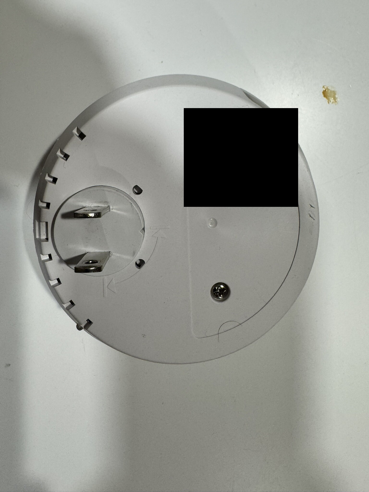
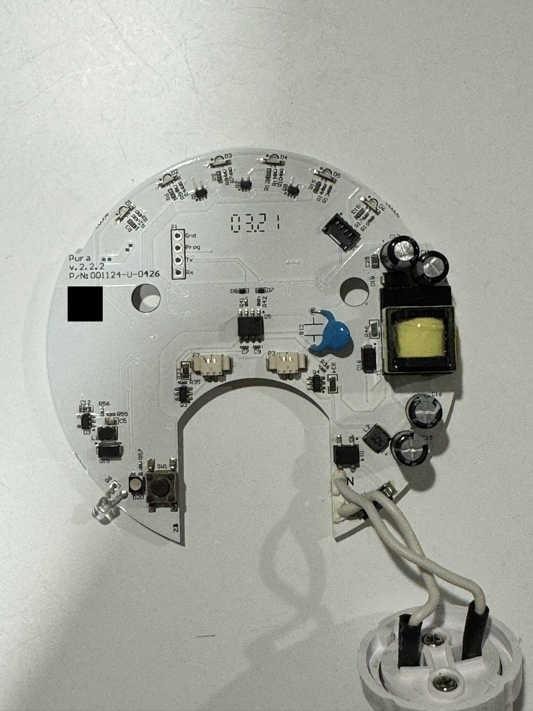
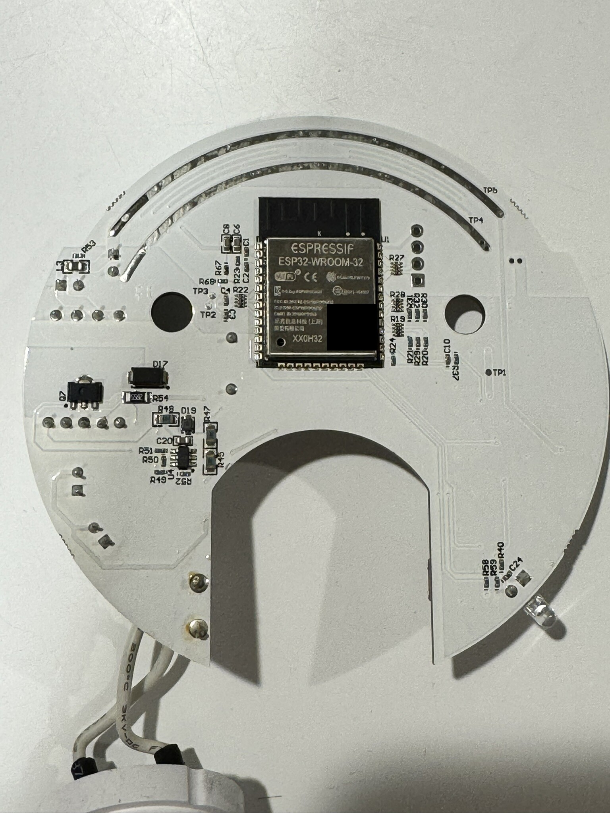
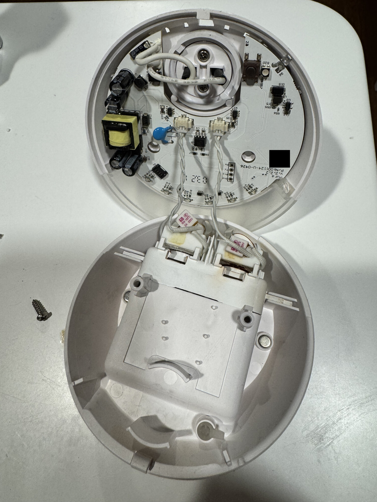
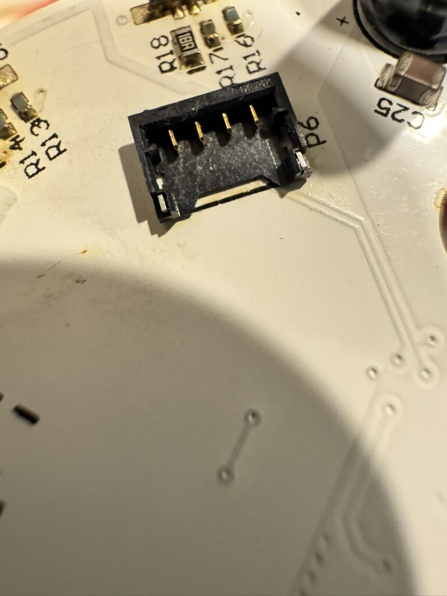
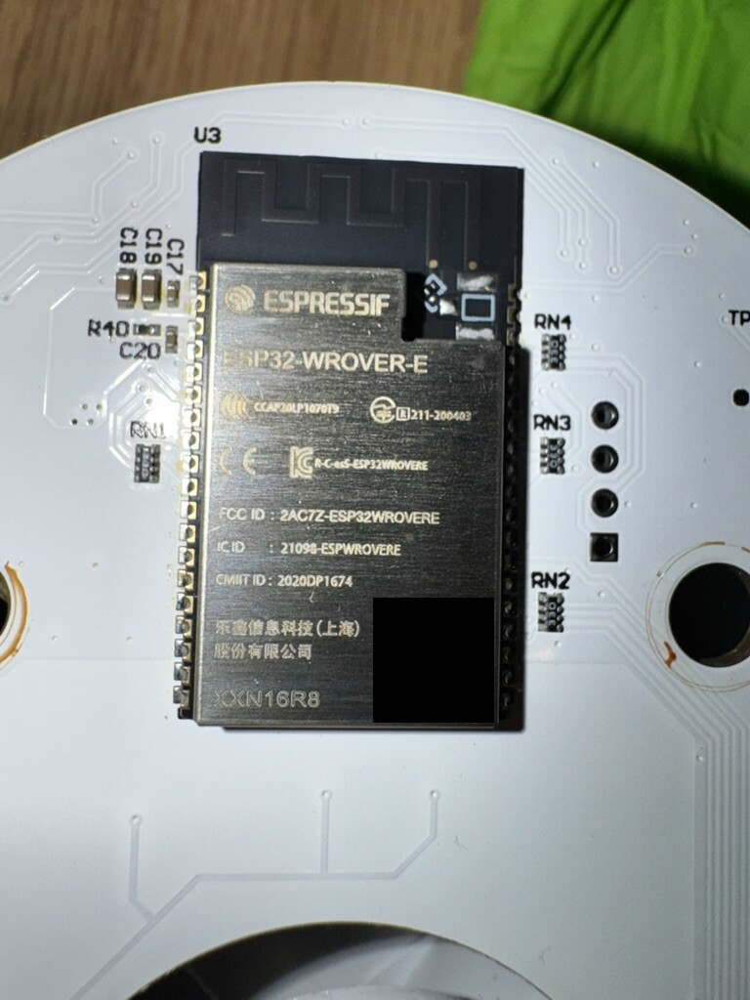
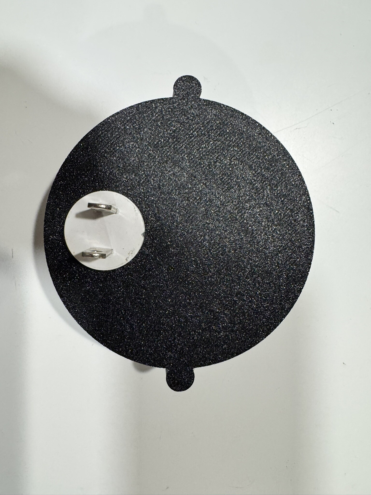
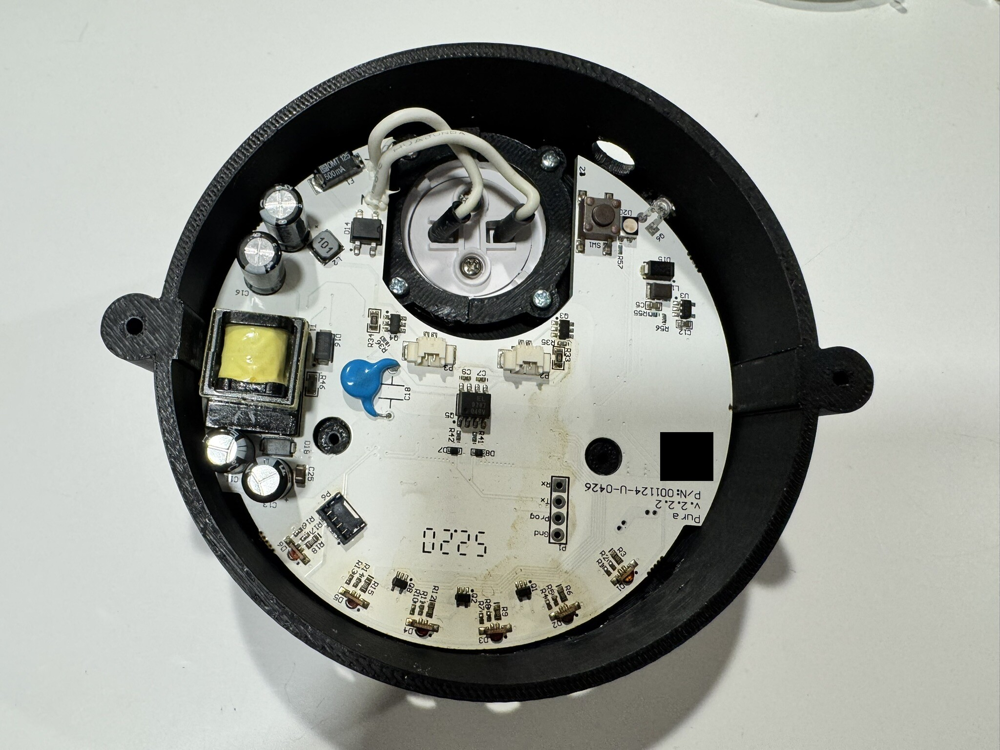

# Hardware reference photos

These show a V2 PCB marked v2.2.2, reported by the stock app as hardware 2.1. They document the original hardware, not a powered teardown procedure. Disconnect mains before opening a device.

Original files are excluded. These copies have generic filenames, no embedded EXIF/GPS/XMP/IPTC metadata, and solid blackouts over visible unit-specific QR/serial labels. Model numbers, PCB revisions, component reference designators and regulatory markings remain where useful. The HEIC photograph was decoded to pixels and exported as a standard JPEG.

## Original rear housing

## Component side

P1 has GND, PROG, TX and RX labels. P2/P3 are the original heater connectors; the black four-position connector near the LED arc is P6.

## ESP32 module side

The ESP32-WROOM-32 and test-point locations are visible. The module's machine-readable code is redacted.

## Open housing and heater assembly

These photographs are for identification. Do not operate an exposed mains board or treat the heater connectors as low-voltage power.

## V2 P6 connector close-up

## V3 ESP32-WROVER-E

This V3 module differs from the V2 WROOM above and reserves GPIO16/17 for PSRAM. Its machine-readable code is redacted.

## Printed enclosure fit photographs

These show a physical prototype with the V2 plug/PCB. They demonstrate a fit check; they do not establish electrical safety or confirm that every pictured part is the final v7 revision.

