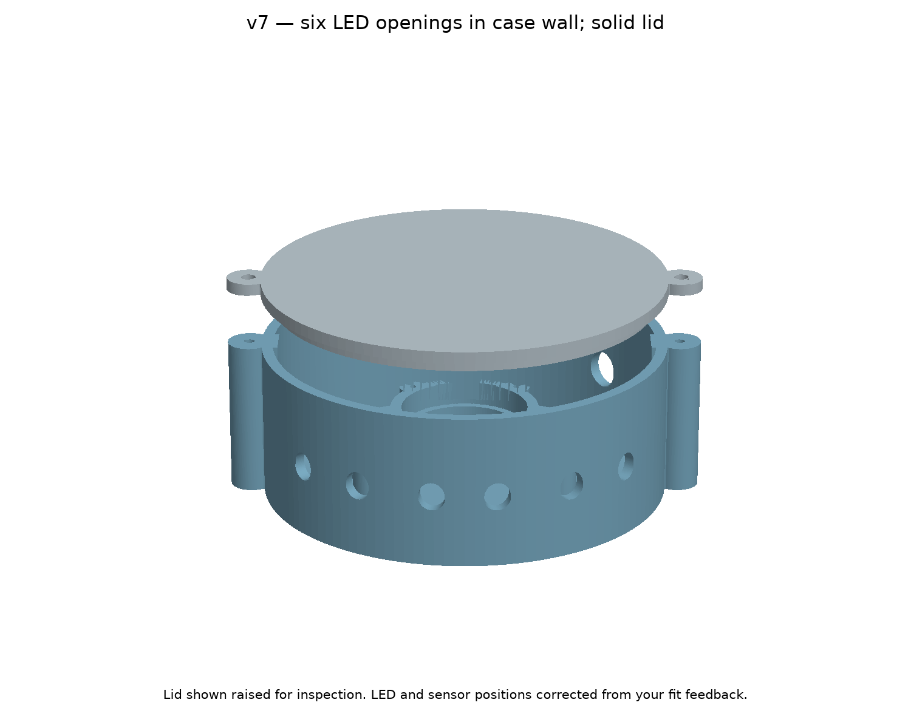

# Pura electronics enclosure v7

Printable **unpowered fit-check prototype** for the measured V2 electronics/plug geometry. V3 fit has not been established. This enclosure has not been qualified for mains insulation, temperature, access protection or plug retention. Do not connect this prototype to mains.



## Print files

All dimensions are millimetres. Download the STL itself using GitHub's raw/download control; a web preview is not a slicer file.

- [Base](print-files/base-TEST-v7.stl)
- [Solid lid](print-files/lid-TEST-v7.stl)
- [Upper plug keeper](print-files/plug-keeper-upper-v7.stl)
- [Lower plug keeper](print-files/plug-keeper-lower-v7.stl)

Print the base flat back down, open tray upward; print lid and keepers in their supplied flat orientation. Starting fit-test settings: 0.20 mm layers, at least 3 walls and 4 top/bottom layers. Review the horizontal LED/sensor bores in the slicer; no supports are designed in. Use the dimensional settings that worked for your gauges. A regular 0.4 mm nozzle is a reasonable starting point for this enclosure, unlike the much smaller connector housing discussed separately.

The body is 92.27 mm diameter, 107.6 mm across mounting tabs and 34.8 mm assembled depth. The base has six 6 mm radial LED openings and one 8 mm sensor opening. Viewed into the base with the LED arc at 12 o'clock, the v7 sensor opening sits around 7:37. D1/D6 moved 5 mm toward the sides; D2/D5 moved 3 mm; D3/D4 stayed in place. Only the base changed from the prior solid-lid/split-keeper revision.

## Unpowered assembly

Fit the original plug flange into its recess. Bring the two keeper halves around the neck from opposite sides, then fasten gently with four M2 × 6 mm screws. The keeper halves leave a 0.30 mm seam. Enclosure screws are two M3 × 10 mm into printed pilots. Proposed PCB screws are M2.5 × 6 mm with insulating washers; verify clearance and engagement before use.

Board supports use 42.80 mm spacing, 5.30 mm locating pegs, 1.70 mm peg height, 8 mm shoulders and 12 mm floor clearance. The flange recess is 30.04 mm; the 25.90 mm neck opening is an estimate. Verify component/wire clearance and that the lid closes freely. Do not bend sensor or LED leads to force alignment. Button access, complete component envelopes and plug retention remain unvalidated.

[REVISION-7.txt](REVISION-7.txt) supersedes old v4 sensor locations and filenames in [ASSEMBLY-NOTES.txt](ASSEMBLY-NOTES.txt). Those older notes are retained for hardware details; use the v7 files linked above.

## Editable sources and checks

`measurements.json` separates measured, assumed and fit-confirmed dimensions. `generate_case.py` uses NumPy, trimesh, manifold3d and matplotlib to regenerate STL files, previews and `validation.json`. `pura-electronics-case.scad` is also supplied as an editable model. Generated meshes were recorded as watertight single solids; this is a geometry check, not electrical approval.

```sh
python3 -m venv .case-venv
.case-venv/bin/pip install numpy trimesh manifold3d matplotlib
.case-venv/bin/python generate_case.py
```

The generator overwrites generated outputs in this folder. Keep a clean copy if comparing revisions. See the root [license](../../../LICENSE) and [hardware reference](../../../docs/hardware.md).

[Physical printed-case fit photos](../../../docs/photos/README.md#printed-enclosure-fit-photographs) are included with the hardware gallery.
